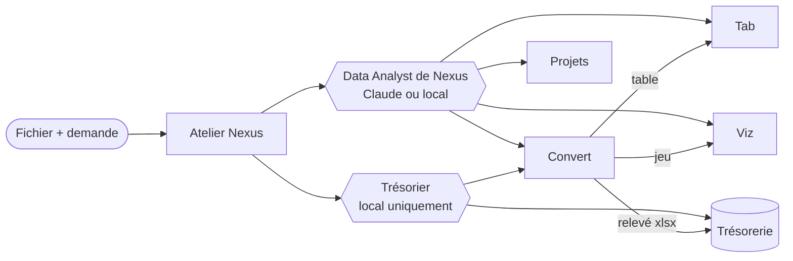

# Agent_DatAnalyst

**Un agent pour Atelier Nexus qui part d'un fichier et le fait circuler dans toute la suite Atelier.**

Dans Nexus, on glisse un fichier dans le chat et on dit ce qu'on veut. L'agent **Data Analyst** de Nexus, complété par cette extension :

| Demande | Ce qu'il fait | Application |
|---|---|---|
| « Convertis ce fichier » | PDF (même scanné), Excel, CSV, OFX/QIF → table typée | Atelier Convert |
| « Extrais le tableau » | Crée une table dans le projet choisi | Atelier Tab |
| « Fais-en une visualisation » | Importe le jeu, vérifie les chiffres, crée un rapport de 1 à 6 visuels | Atelier Viz |
| « Crée les tâches du projet » | Projet › phase › epic › story › tâches, en une validation | Atelier Projets |

Les finances vont à un second agent, le **Trésorier**, verrouillé sur le modèle local (Ollama) : comptes bancaires, import de relevé, achats de matériel, placements (titres, ETF, or, argent…) dans **Atelier Trésorerie**. Ces données ne quittent jamais la machine.

Chaque écriture s'arrête sur une carte de validation dans Nexus : rien n'est créé sans votre accord.

## Architecture



Ce dépôt est une **extension** de Nexus : un paquet Python (`atelier_datanalyst`) que Nexus charge au démarrage. Tout le code de l'agent vit ici ; Nexus n'apporte que le chargeur d'extensions et l'accès aux fichiers joints ([Atelier_Nexus#29](https://github.com/m6rdxc9g4t-beep/Atelier_Nexus/pull/29), [#30](https://github.com/m6rdxc9g4t-beep/Atelier_Nexus/pull/30)). Détails : [docs/architecture.md](docs/architecture.md).

## Installer dans Nexus

Prérequis : Atelier Nexus à jour (`main` avec les PR #29 et #30), et les applications lancées (ports par défaut : Viz 8000, Projets 3000, Trésorerie 5050, Convert 8010).

**App de bureau (macOS)** — son environnement Python est refait à partir du dépôt de Nexus, un `pip install` y serait perdu ; l'extension n'a aucune dépendance, il suffit de dire à Nexus où elle est :

```bash
cd ~/dev
git -C Atelier_Nexus pull
git clone https://github.com/m6rdxc9g4t-beep/Agent_DatAnalyst.git
```

Puis dans Atelier Nexus : menu **Réglages → Ouvrir le fichier de réglages** (`~/Library/Application Support/Atelier Nexus/.env`), ajouter à la fin et relancer l'app :

```bash
NEXUS_PLUGINS=atelier_datanalyst
NEXUS_PLUGIN_PATHS=/Users/<vous>/dev/Agent_DatAnalyst/src
# CONVERT_BASE_URL=http://127.0.0.1:8010/api   # valeur par défaut
```

**Serveur de développement** : `pip install -e ../Agent_DatAnalyst` dans l'environnement du backend (ou le même `NEXUS_PLUGIN_PATHS`), puis `NEXUS_PLUGINS=atelier_datanalyst` dans `backend/.env`.

Le **Data Analyst** (catégorie Données) gagne Convert, les écritures Viz et le plan Projets ; **Trésorier** apparaît dans Finance. Avec une version de Nexus antérieure à `extend_agent`, un agent séparé « Data Analyst Atelier » est créé à la place. Si rien n'apparaît : `~/Library/Logs/Atelier Nexus/atelier-nexus.log`, ligne « Extension « atelier_datanalyst » … ». Une application non lancée ou non configurée est simplement écartée ; l'agent garde ses autres outils.

## Outils ajoutés

| Boîte | Outils | Écrit ? |
|---|---|---|
| `fichiers` | `conversation_files` | non |
| `convert` | `convert_list_conversions`, `convert_read_table` (relevés bancaires refusés), `convert_tab_projects` | non |
| `convert_releves` | les mêmes, relevés bancaires lus aussi (Trésorier) | non, **sensible** |
| `convert_write` | `convert_file`, `convert_send_to_tab`, `convert_send_to_viz` | oui, validé |
| `data_via_write` | `data_via_import_file`, `data_via_create_report` | oui, validé |
| `projets_plan` | `projets_create_plan` | oui, validé |
| `tresorerie_write` | `tresorerie_preview_import` (lecture), `tresorerie_import_statement`, `tresorerie_create_account`, `tresorerie_add_transaction`, `tresorerie_add_holding` | oui, validé, **sensible** |

Le Data Analyst réutilise aussi les boîtes fournies par Nexus : `data_via` (lecture Viz), `tab`, `tab_write`, `tab_projets`, `projets_read`, `projets_write`.

## Garde-fous

- **Validation humaine** de toute écriture, avec un résumé concret (« Créer dans Atelier Viz le rapport « Ventes 2026 » (3 visuels : …) »).
- **Confidentialité** : tout outil Trésorerie est `sensitive` ; l'agent qui l'utilise ne peut pas tourner sur Claude. Le Data Analyst n'a aucun outil Trésorerie et oriente vers le Trésorier.
- **Relevés bancaires** : le Data Analyst (Claude possible) ne lit pas les lignes d'une conversion reconnue comme relevé (`convert_read_table` refuse et oriente vers le Trésorier) ; le Trésorier les lit par la boîte sensible `convert_releves`. Envoyer un relevé dans Tab ou Viz reste possible (écriture validée) : il devient alors lisible par les agents qui lisent ces applications.
- **Atelier Convert** : adresse `CONVERT_BASE_URL` lue dans les réglages de Nexus (rechargée à chaud ; repli sur celle de l'extension avec un Nexus plus ancien), adresse locale seulement.
- **Fichiers** : un outil ne voit que les fichiers cités par la conversation en cours ; leur contenu n'est jamais renvoyé au modèle par les outils.
- **Pas de doublon** : clés d'idempotence stables sur Convert et Viz ; Trésorerie ignore les opérations déjà importées ; un plan Projets interrompu dit ce qui existe déjà.
- **Viz sans IA tierce, fermé par défaut** : les visuels sont contrôlés contre le schéma relu au moment d'écrire (colonnes, agrégations permises par type, une seule mesure pour secteurs / KPI…), puis par Atelier Viz (`/ai/visuals/repair`, sans appel à son IA). Viz corrigerait certains visuels en silence : si le visuel changerait par rapport à celui que vous avez validé, rien n'est écrit et l'agent repropose. La carte de validation décrit chaque visuel (« Courbes « CA par mois » : somme de chiffre_affaires par date (mois) »).
- **Aucun endpoint inventé** : chaque route appelée a été lue dans le dépôt de l'application (référence dans la docstring de chaque module).

## Vérifié contre les vraies applications

Les outils ont été joués contre Viz, Convert, Projets et Trésorerie lancés (données de démonstration) : CSV → jeu et rapport Viz de 6 visuels (chaque visuel recalculé par le moteur de Viz), PDF → table Tab et jeu Viz, plan Projets complet, compte, achat de matériel, lingots d'or, ETF, import de relevé PDF (second import : tout en doublons), plus 14 cas d'erreur. Deux corrections en sont sorties : refus « fermé par défaut » ci-dessus, et un bug de Nexus sur l'origine des jeux publiés (corrigé dans #29).

Rejouer (écrit de vraies données : applications de démonstration uniquement) :

```bash
cd Atelier_Nexus/backend
NEXUS_PLUGINS=atelier_datanalyst PYTHONPATH=. python ../../Agent_DatAnalyst/scripts/parcours_reel.py
NEXUS_PLUGINS=atelier_datanalyst PYTHONPATH=. python ../../Agent_DatAnalyst/scripts/parcours_erreurs.py
```

## Développer

```bash
# Atelier_Nexus cloné à côté de ce dépôt (ou NEXUS_BACKEND=/chemin/backend)
cd Agent_DatAnalyst
pytest                    # 18 tests, applications simulées, aucun appel réseau
ruff check src tests
MYPYPATH=src:../Atelier_Nexus/backend mypy
```

CI : le lint tourne toujours ; tests et typage ont besoin du secret `NEXUS_REPO_TOKEN` (jeton GitHub en lecture seule sur Atelier_Nexus, à ajouter dans Settings › Secrets and variables › Actions). Sans lui, ils sont signalés comme sautés.

Évaluation des agents sur le banc de Nexus : [evals/](evals/). Conventions : [CLAUDE.md](CLAUDE.md).
