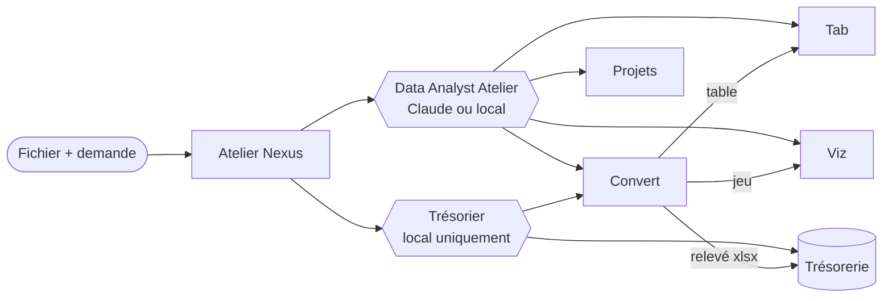

# Agent_DatAnalyst

**Un agent pour Atelier Nexus qui part d'un fichier et le fait circuler dans toute la suite Atelier.**

Dans Nexus, on glisse un fichier dans le chat et on dit ce qu'on veut. L'agent **Data Analyst Atelier** :

| Demande | Ce qu'il fait | Application |
|---|---|---|
| « Convertis ce fichier » | PDF (même scanné), Excel, CSV, OFX/QIF → table typée | Atelier Convert |
| « Extrais le tableau » | Crée une table dans le projet choisi | Atelier Tab |
| « Fais-en une visualisation » | Importe le jeu, vérifie les chiffres, crée un rapport de 1 à 6 visuels | Atelier Viz |
| « Crée les tâches du projet » | Projet › phase › epic › story › tâches, en une validation | Atelier Projets |

Les finances vont à un second agent, le **Trésorier**, verrouillé sur le modèle local (Ollama) : comptes bancaires, import de relevé, achats de matériel, placements (titres, ETF, or, argent…) dans **Atelier Trésorerie**. Ces données ne quittent jamais la machine.

Chaque écriture s'arrête sur une carte de validation dans Nexus : rien n'est créé sans votre accord.

## Architecture



Ce dépôt est une **extension** de Nexus : un paquet Python (`atelier_datanalyst`) que Nexus charge au démarrage. Tout le code de l'agent vit ici ; Nexus n'apporte que le chargeur d'extensions et l'accès aux fichiers joints ([Atelier_Nexus#29](https://github.com/m6rdxc9g4t-beep/Atelier_Nexus/pull/29)). Détails : [docs/architecture.md](docs/architecture.md).

## Installer dans Nexus

Prérequis : Atelier Nexus avec la PR #29 fusionnée, et les applications lancées (ports par défaut : Viz 8000, Projets 3000, Trésorerie 5050, Convert 8010).

```bash
# dans l'environnement Python du backend de Nexus
cd Atelier_Nexus/backend
pip install -e ../../Agent_DatAnalyst

# backend/.env
NEXUS_PLUGINS=atelier_datanalyst
CONVERT_BASE_URL=http://127.0.0.1:8010/api   # valeur par défaut
```

Relancez Nexus : **Data Analyst Atelier** apparaît dans la catégorie Données, **Trésorier** dans Finance. Une application non lancée ou non configurée est simplement écartée ; l'agent garde ses autres outils.

## Outils ajoutés

| Boîte | Outils | Écrit ? |
|---|---|---|
| `fichiers` | `conversation_files` | non |
| `convert` | `convert_list_conversions`, `convert_read_table`, `convert_tab_projects` | non |
| `convert_write` | `convert_file`, `convert_send_to_tab`, `convert_send_to_viz` | oui, validé |
| `data_via_write` | `data_via_import_file`, `data_via_create_report` | oui, validé |
| `projets_plan` | `projets_create_plan` | oui, validé |
| `tresorerie_write` | `tresorerie_preview_import` (lecture), `tresorerie_import_statement`, `tresorerie_create_account`, `tresorerie_add_transaction`, `tresorerie_add_holding` | oui, validé, **sensible** |

Le Data Analyst réutilise aussi les boîtes fournies par Nexus : `data_via` (lecture Viz), `tab`, `tab_write`, `tab_projets`, `projets_read`, `projets_write`.

## Garde-fous

- **Validation humaine** de toute écriture, avec un résumé concret (« Créer dans Atelier Viz le rapport « Ventes 2026 » (3 visuels : …) »).
- **Confidentialité** : tout outil Trésorerie est `sensitive` ; l'agent qui l'utilise ne peut pas tourner sur Claude. Le Data Analyst n'a aucun outil Trésorerie et oriente vers le Trésorier.
- **Fichiers** : un outil ne voit que les fichiers cités par la conversation en cours ; leur contenu n'est jamais renvoyé au modèle par les outils.
- **Pas de doublon** : clés d'idempotence stables sur Convert et Viz ; Trésorerie ignore les opérations déjà importées ; un plan Projets interrompu dit ce qui existe déjà.
- **Viz sans IA tierce** : les visuels proposés par l'agent sont validés par Atelier Viz (`/ai/visuals/repair`, sans appel à l'IA de Viz) contre le schéma relu au moment d'écrire.
- **Aucun endpoint inventé** : chaque route appelée a été lue dans le dépôt de l'application (référence dans la docstring de chaque module).

## Développer

```bash
# Atelier_Nexus cloné à côté de ce dépôt (ou NEXUS_BACKEND=/chemin/backend)
cd Agent_DatAnalyst
pytest                    # 18 tests, applications simulées, aucun appel réseau
ruff check src tests
MYPYPATH=src:../Atelier_Nexus/backend mypy
```

Évaluation des agents sur le banc de Nexus : [evals/](evals/). Conventions : [CLAUDE.md](CLAUDE.md).
